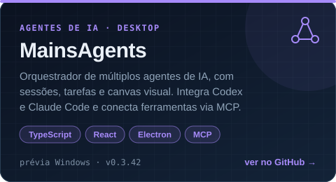
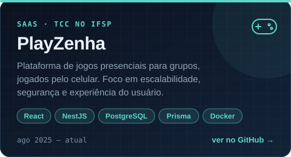
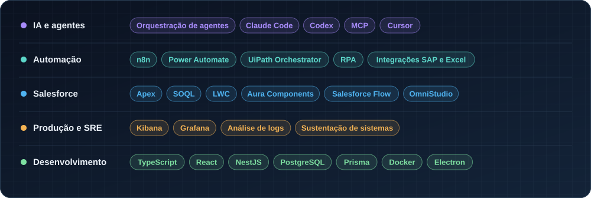

  

  
  
  

 

## 👋 Sobre mim

Trabalho com **automação de processos, desenvolvimento de software e sustentação de sistemas em produção**. Gosto de usar IA para simplificar processos e criar soluções úteis para o negócio.

- ⚙️ **Agora:** automações com n8n e práticas de SRE, investigando falhas com Kibana e Grafana na **Engineering Brasil**
- ☁️ **Antes:** desenvolvimento Salesforce na **Vivo** e automações RPA com UiPath e Power Automate
- 🤖 **Nos projetos próprios:** orquestração de agentes de IA com Claude Code, Codex e MCP
- 🎓 **Formação:** Análise e Desenvolvimento de Sistemas no **IFSP**, com previsão de conclusão em dez/2026

 

## 💼 Experiência

  

<table>
<tr>
<td width="33%" valign="top">

**🤖 Desenvolvedor RPA** 
Projetos de Automação · ago 2024 – jul 2025

- Ciclo completo dos robôs, do levantamento de requisitos ao deploy e monitoramento
- Filas, logs e robôs no **UiPath Orchestrator**
- Migração para **Power Automate**, integrando dados entre Excel, SAP e plataformas web

</td>
<td width="33%" valign="top">

**☁️ Desenvolvimento Salesforce** 
Vivo (Telefônica Brasil) · out 2025 – ago 2026

- Investigação e resolução de incidentes na sustentação da plataforma
- **Desenvolvi** OmniScript no OmniStudio e **mantive** automações em **Salesforce Flow**
- Componentes em **LWC** e **Aura**, back-end em **Apex** e consultas **SOQL** otimizadas

</td>
<td width="33%" valign="top">

**⚙️ Produção Júnior · Automação e SRE** 
Engineering Brasil · ago 2026 – atual

- Crio automações com **n8n** para reduzir tarefas manuais da operação
- Acompanho logs e sinais operacionais em **Kibana** e **Grafana** para investigar falhas
- Uso o **Cursor** no desenvolvimento assistido por IA

</td>
</tr>
</table>

 

## 🚀 Projetos em destaque

<table>
<tr>
<td width="50%" align="center">
  
   
  <a href="https://github.com/devpedrohbs/MainsAgents">Código</a> · <a href="https://github.com/devpedrohbs/MainsAgents/releases/tag/v0.3.42">Baixar prévia para Windows</a>
</td>
<td width="50%" align="center">
  
   
  <a href="https://github.com/devpedrohbs/PlayZenha">Código</a> · TCC no IFSP
</td>
</tr>
</table>

**Também no portfólio:** **RunLab**, app voltado à corrida, e [**Servidor HTTP**](https://github.com/devpedrohbs/Servidor-HTTP), uma implementação em Java para praticar operações HTTP.

**Extensão:** fui mentor e desenvolvedor no **Women in Tech** do IFSP (jun–set 2025). Estruturei trilhas de aprendizado e mentorei participantes em programação.

 

## 🧰 Stack

  

  Mogi das Cruzes, SP · Português nativo · Inglês intermediário (B1)

