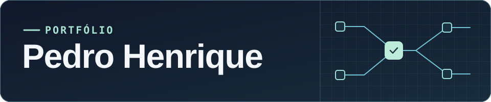

# 

**Desenvolvedor · IA e automações · Salesforce · DevOps e observabilidade**

Desenvolvo aplicações e integrações para automatizar processos. Minha experiência passa por desenvolvimento em Salesforce e observabilidade em Google Cloud e Kubernetes. Em projetos próprios, trabalho com agentes de IA, aplicações desktop e produtos web.

**[LinkedIn ↗](https://www.linkedin.com/in/pedro-batista-174b682aa/)**

## Projetos em destaque

### MainsAgents

**Agentes de IA · Aplicativo desktop**

Workspace para criar e operar agentes especializados. Reúne sessões, tarefas e um canvas visual, com integração ao Codex e ao Claude Code.

`TypeScript` `React` `Electron`

[Ver código ↗](https://github.com/devpedrohbs/MainsAgents) · [Prévia para Windows ↗](https://github.com/devpedrohbs/MainsAgents/releases/tag/v0.3.42)

### PlayZenha

**Aplicação web · Jogos sociais**

App de jogos para jogar em grupo pelo celular. A interface reúne o catálogo e as partidas, enquanto a API cuida da autenticação e do acesso aos jogos.

`React` `TypeScript` `NestJS` `PostgreSQL`

[Ver código ↗](https://github.com/devpedrohbs/PlayZenha)

**Também no portfólio** · **RunLab**, projeto de app voltado à corrida, e [Servidor HTTP](https://github.com/devpedrohbs/Servidor-HTTP), uma implementação em Java para praticar operações HTTP.

## Experiência e tecnologias

- **IA e automação** · Agentes de IA, integrações via API, n8n e Microsoft Power Automate.
- **Salesforce** · Apex, SOQL, Salesforce Flow, Lightning Web Components (LWC) e OmniStudio.
- **DevOps e observabilidade** · Google Cloud (GCP), Kubernetes, Grafana e ELK (Elasticsearch, Logstash e Kibana).
- **Dados** · Consultas em Oracle SQL.
